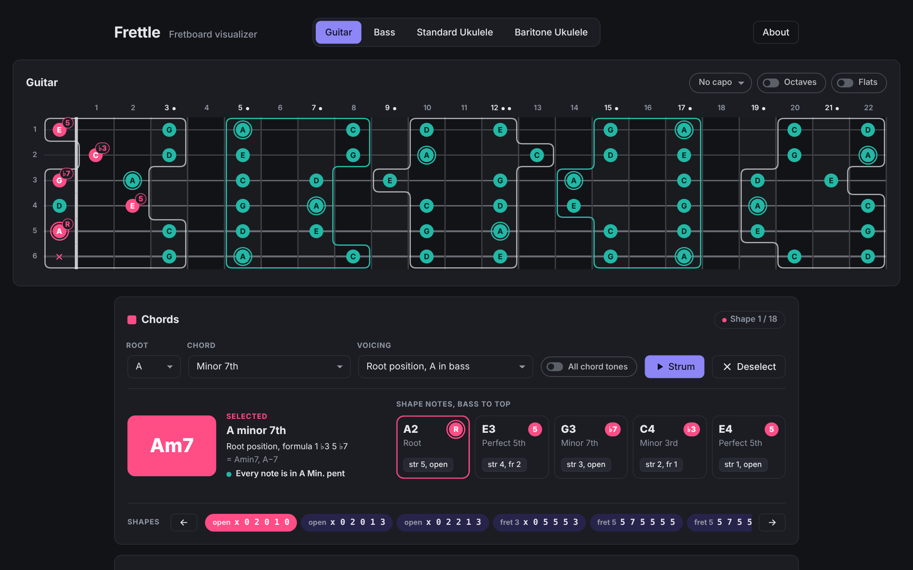
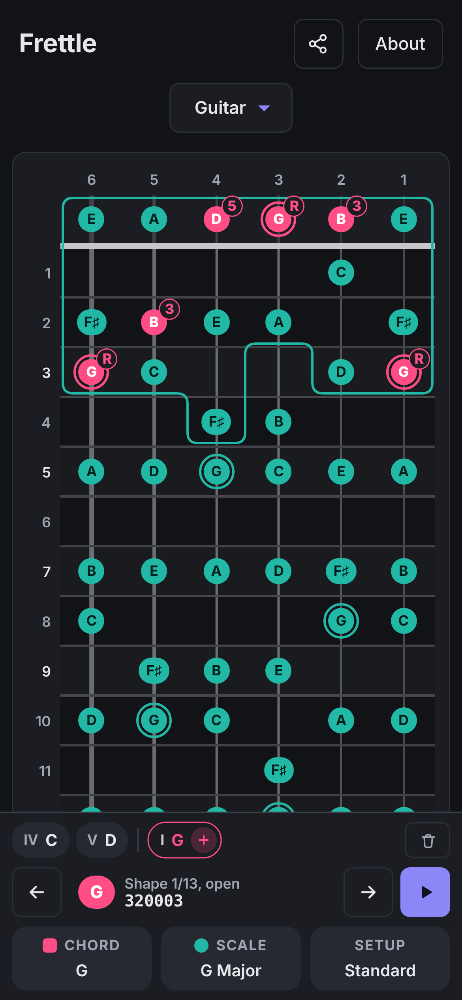
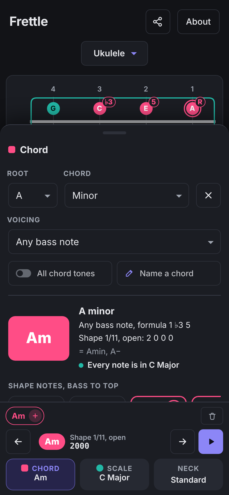

# Frettle

A fretboard visualizer for guitar, bass, ukulele, mandolin, mandola and banjo. Pick a chord or a scale and see where every note sits on the neck.

**Try it at [frettle.gruvw.com](https://frettle.gruvw.com)**

<p align="center">
  
</p>

<p align="center">
  
  &nbsp;&nbsp;
  
</p>

## What it does

- Shows every note on the neck for guitar (6 or 7 strings), bass (4 or 5 strings), ukulele (standard and baritone), mandolin, mandola and 5-string banjo (its short drone string included)
- Common alternate tunings: guitar Drop D, DADGAD, open G, half step down and a few more, ukulele high or low G, banjo double C, G modal and open D
- Chords: pick a root and a type, then flip through the shapes up the neck. Each note shows its interval (R, 3, 5...) and barres are drawn in
- Recent chords stay in a row, so you can jump between the chords of a song. Each one keeps the shape you picked
- Scales: the modes, minors, pentatonics, blues and a few more, with their formula, the scales that share their notes and the triads that fit. You can split the scale into hand-sized groups or hide the notes outside it
- Capo, octave shading, a left-handed mode, and tap any note to hear it or strum the whole chord
- Tells you when a chord fits the scale you picked
- Spells notes for the key, so you get F♯ in D major and B♭ in F major
- Built for phones first, works offline once loaded, and can be added to your home screen (PWA)

## Running it yourself

There's nothing to build or install. The static website is in the `web/` directory: an HTML, a CSS and a JS file, plus the manifest, service worker and icons.

```sh
cd web
python3 -m http.server
```

Then open http://localhost:8000. Opening `index.html` straight from disk works too, you just don't get offline mode.

No frameworks or libraries. The sound is synthesized in the browser, and your settings are saved in localStorage.
